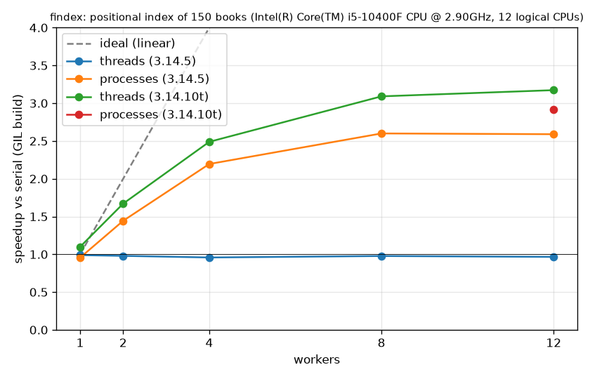

# findex

[](https://github.com/daideneg28-prog/findex/actions/workflows/ci.yml)
[](https://github.com/daideneg28-prog/findex/releases)

**Живе демо: https://findex-e2xj.onrender.com** (UI) · [API-документація `/docs`](https://findex-e2xj.onrender.com/docs) ·
[`/health`](https://findex-e2xj.onrender.com/health). Безкоштовний інстанс Render засинає без трафіку: перший запит після паузи йде ~50 с.

Невелика пошукова система, яку я будую протягом семестру в курсі
«Python програмування» ([опис курсу](https://github.com/rmalkevy/Programming-Practice-Projects/blob/main/courses/python/README.md)).
Кожна лабораторна додає одну можливість мови й один крок проєкту; кожна позначена git-тегом `lab-0N`.

## Корпус

**Project Gutenberg**: 150 англомовних книг (~86 MB тексту, ~15 млн токенів), одна книга = один документ.
Корпус не зберігається в git (`data/` у `.gitignore`). Щоб отримати його:

```bash
uv run python scripts/download_corpus.py --count 150
```

Скрипт бере список англомовних текстів з офіційного каталогу `pg_catalog.csv`, завантажує UTF-8 версії
в `data/gutenberg/<id>.txt` і вирізає ліцензійний заголовок і підвал Gutenberg (з паузою 1 с між запитами).

## Встановлення

Як інструмент командного рядка, з wheel у [GitHub Release](https://github.com/daideneg28-prog/findex/releases):

```bash
uv tool install https://github.com/daideneg28-prog/findex/releases/download/v0.4.0/findex-0.4.0-py3-none-any.whl
findex --help
```

Для розробки:

```bash
uv sync
uv run pytest            # тести (+ --cov для покриття)
uv run ruff check .      # лінтер
uv run pyright           # типи, strict
uv tool install .        # `findex` у PATH з робочої копії
```

---

## Лаб 1: ітератори, генератори та корпус

**Що зроблено**

| Модуль | Що робить |
|---|---|
| `src/findex/corpus.py` | `iter_documents(root)`: генератор `Document(doc_id, path, text)`. Обходить теку ліниво через `rglob`, підтримує `.txt` і `.jsonl`. Файл з битим кодуванням не валить програму: пише попередження в лог і читає з `errors="replace"`. |
| `src/findex/tokenize.py` | `tokenize(text)`: генератор токенів через `re.finditer` після NFC і `casefold()`. |
| `src/findex/stats.py` | Конвеєр `документи → токени → Counter` за один прохід. CLI `python -m findex.stats data/` друкує кількість документів і токенів, розмір словника, топ-50 термів, час і пікову пам'ять (`tracemalloc`). `--limit N` реалізовано через `itertools.islice`. `--mode eager` вмикає навмисно «жадібну» версію для порівняння. |
| `tests/test_tokenize.py` | 10 перевірок токенізатора: регістр, кирилиця, комбіновані діакритики, пунктуація, апострофи, дефіси, цифри, порожній рядок. |

Те, що обидві функції є генераторами, перевіряє `inspect.isgeneratorfunction(tokenize)` у тестах.
`next(iter_documents(Path("data")))` повертає першу книгу одразу, не читаючи решту корпусу.

### Правила токенізації

1. **Нормалізація**: спочатку Unicode NFC, потім `str.casefold()`. NFC об'єднує `e` + `U+0301` в один символ `é`, тож
   `café` записане двома способами дає один токен. `casefold()` агресивніший за `lower()`: `"Straße"` → `"strasse"`, тому збігається з `"STRASSE"`.
2. **Токен** — послідовність літер і цифр будь-якої мови (`[^\W_]`, `_` не входить). Комбіновані знаки, що лишилися після NFC
   (наголос над кириличною `а́`, для якої немає готового символу), лишаються всередині слова й не розривають його.
3. **Апострофи** між літерами зберігають слово цілим: `don't`, `п'ять`. Варіанти `’` (U+2019) і `ʼ` (U+02BC) зводяться до `'`,
   тож усі написання `п'ять` дають один токен. Апострофи на початку чи в кінці слова (лапки) відкидаються.
4. **Дефіси** розділяють слова: `state-of-the-art` → `state`, `of`, `the`, `art`, щоб запит `art` знаходив такий документ.
5. **Цифри** — окремі токени: `1984` → `1984`; `3.14` → `3`, `14`; змішані послідовності на кшталт `covid19` лишаються одним токеном.

### Результати на всьому корпусі

```
$ uv run python -m findex.stats data/
documents:   150
tokens:      15,025,665
vocabulary:  200,251
elapsed:     45.01 s
peak memory: 85.8 MiB
top: the 782,327 · and 499,954 · of 430,196 · to 333,918 · a 274,585 · ...
```

### Eager проти lazy

Обидві версії рахують те саме на однаковому зрізі корпусу (`--limit N --mode eager|lazy`).
Python 3.14.5, Windows 11, 16 GB RAM; пам'ять міряє `tracemalloc` (пік), час — `time.perf_counter()`.

| Версія | Документи | Токени | Пікова пам'ять | Час |
|---|---:|---:|---:|---:|
| eager (списки) | 20 | 3 241 152 | 219.2 MiB | 9.47 s |
| lazy (генератори) | 20 | 3 241 152 | 85.8 MiB | 9.28 s |
| eager (списки) | 75 | 9 344 491 | 630.6 MiB | 28.31 s |
| lazy (генератори) | 75 | 9 344 491 | 85.8 MiB | 27.55 s |
| eager (списки) | 150 | 15 025 665 | 1015.6 MiB | 45.85 s |
| lazy (генератори) | 150 | 15 025 665 | 85.8 MiB | 45.01 s |

**Чому так.** Пам'ять eager-версії росте лінійно з розміром корпусу: близько 65 байтів на кожен токен.
Вона одночасно тримає три речі: список усіх текстів (~86 MB рядків), список списків токенів і плаский список `flat`.
Кожен з 15 млн токенів — окремий об'єкт `str` (~50–60 байтів з заголовком) плюс 8-байтовий вказівник у кожному списку, де він лежить.
У lazy-версії пам'ять **однакова для 20, 75 і 150 книг**, тобто не залежить від розміру корпусу.
У кожен момент у пам'яті лише одна книга, її нормалізовані копії і `Counter`.

Пам'ять lazy-версії **не нульова** з двох причин:
1. `Counter` — це відповідь, і він мусить рости: 200 тис. унікальних слів разом з рядками й хеш-таблицею займають десятки MiB.
2. Найбільший документ (`100.txt`, повний Шекспір, 5.5 MB) у моменті існує в кількох копіях: прочитаний текст, результат
   `normalize("NFC")` і результат `casefold()`. Через не-ASCII символи (`’`) Python зберігає його по 2 байти на символ, тож пік
   припадає саме на цю книгу.

Час майже однаковий, бо роботу виконує той самий токенізатор. Eager трохи повільніший через виділення пам'яті під мільйони
об'єктів і розширення списків. Генератори дають виграш у пам'яті, а не в швидкості.

---

## Лаб 2: інвертований індекс, словники, хешування та пам'ять

**Що зроблено**

| Модуль | Що робить |
|---|---|
| `src/findex/index.py` | `build_index(docs, representation, positions)`: один потоковий прохід по корпусу. Для кожного документа рахує власний `Counter` і після документа «скидає» його в глобальний `defaultdict(list)`. `doc_id` призначаються по порядку потоку, тому кожен список постингів **уже відсортований** за `doc_id`, без окремого сортування. Також будує `doc_lengths` (знадобиться для BM25 у Лаб 3) і `doc_meta` (назва книги з `titles.json`). |
| | `Posting` і `DocMeta` мають `@dataclass(frozen=True, slots=True)`: незмінні, хешовані, без `__dict__`. `PlainPosting` — той самий клас без `slots`, лише для порівняння пам'яті. |
| `src/findex/search.py` | Булевий пошук: `a b` (неявне AND), `OR`, `NOT`, обчислення зліва направо. AND/OR/NOT реалізовані **злиттям двома вказівниками** по відсортованих списках (O(n+m), без хешування). `--engine set` вмикає ту саму логіку через `set`. |
| `src/findex/store.py` | `save`/`load` у двох форматах: `.pkl` (pickle) і `.json` (стовпчиковий: `term → [[doc_ids], [tfs]]`). |
| `scripts/bench_lab02.py` | Відтворює всі три таблиці нижче. |
| `tests/test_index.py` | 20 тестів: сортування й tf, хешованість, позиції, злиття = множини, парсер запиту, булеві запити на обох рушіях, round-trip збереження для всіх представлень і форматів, регресія CLI. |

```
$ uv run python -m findex.index data/ --out data/index.pkl
documents:    150
terms:        200,251
postings:     1,086,342
build:        48.96 s
index in RAM: 98.4 MiB (peak 132.8 MiB)
saved:        data\index.pkl (18.4 MiB, 3.93 s)

$ uv run python -m findex.search data/index.pkl "whale ship NOT shakespeare"
10 documents match 'whale ship NOT shakespeare'  (engine=merge)
  [   1] The King James Version of the Bible  (10)
  [   4] The Tragedy of Pudd'nhead Wilson  (102)
  ...
load: 10.05 s · search: 0.203 ms · peak memory: 255.6 MiB
```

(Завантаження в CLI повільніше, ніж у таблиці, бо під час нього працює `tracemalloc`. Він перехоплює кожне виділення пам'яті,
а pickle створює мільйон об'єктів.)

> ⚠️ **pickle небезпечний.** `pickle.load` виконує довільний код: pickle-файл — це програма для unpickler-а, і через
> `__reduce__` вона може викликати будь-яку функцію, наприклад `os.system`. Тому `load()` можна застосовувати **лише до
> індексів, які ви зібрали самі**. Ніколи не завантажуйте pickle з інтернету чи з мережі. JSON-формат безпечний: він може
> створити тільки словники, списки, рядки й числа.

**Баг, на якому я дещо зрозумів.** Перша версія `python -m findex.index` створювала pickle, який `findex.search` не міг
прочитати: `AttributeError: module '__main__' has no attribute 'Posting'`. Під `-m` файл виконується як модуль `__main__`,
тому pickle записав класи як `__main__.Posting`. Pickle зберігає не сам клас, а **шлях імпорту** до нього. Виправлення:
блок `if __name__ == "__main__"` імпортує справжній `findex.index` і викликає `main()` звідти. Тест `test_cli_pickle_is_loadable`
стежить, щоб баг не повернувся.

### Пам'ять: три представлення постингів

150 документів, 200 251 терм, 1 086 342 постинги. Python 3.14.5.

| Представлення постингів | Індекс у RAM | Пік (побудова) | Побудова | Pickle-файл | Завантаження pickle |
|---|---:|---:|---:|---:|---:|
| `list[Posting]`, звичайний `@dataclass` | 139.8 MiB | 157.4 MiB | 47.8 s | 24.6 MiB | 1.02 s |
| `list[Posting]`, `slots=True` | 98.4 MiB | 132.8 MiB | 47.7 s | 18.4 MiB | 4.30 s |
| пари `array('I')` (doc_ids, tfs) | **72.2 MiB** | 123.5 MiB | 45.1 s | 17.0 MiB | **0.34 s** |
| `list[Posting]`, `slots=True` + позиції | 720.1 MiB | 727.9 MiB | 68.8 s | 78.1 MiB | 5.56 s |

**Куди пішли байти** (розміри з `sys.getsizeof` на цій машині):

- **`slots=True`**: об'єкт `Posting` займає 56 B (заголовок і три слоти по 8 B), плюс 8 B вказівник у списку, разом **~64 B на постинг**.
  1.09 млн × 64 B ≈ 66 MiB. Решту ~32 MiB становлять 200 тис. рядків-термів, хеш-таблиця словника і 200 тис. об'єктів `list` (56 B порожній).
- **Звичайний `@dataclass`**: +41 MiB, тобто **~38 B зайвих на постинг**. Це менше, ніж «~100 B на `__dict__`» з теорії, бо з Python 3.13
  атрибути звичайних об'єктів зберігаються «inline», а справжній `__dict__` (296 B) створюється лише при зверненні до нього.
  `slots` усе одно виграє 30%.
- **`array('I')`**: кожен постинг займає рівно **8 B** (два 4-байтові `uint32`), без об'єктів. Самі дані — лише 8.3 MiB.
  Але виграш лише ~26%, а не 8×, бо в нашому корпусі **постингів на терм мало** (у середньому 5.4, більшість термів трапляється
  в одній книзі). Кожен терм несе фіксовані витрати: два порожні `array` по 80 B, кортеж, рядок-терм і слот у словнику. На 200 тис.
  термів це ~60 MiB, які однакові для всіх варіантів. `array` перемагає на довгих списках; що більше документів, то більший розрив.
- **Позиції** збільшують індекс у **7.3 рази**. 15 млн позицій — це `int` до 900 000, а кешуються лише малі (−5…256), тож кожна
  позиція займає 28 B на об'єкт `int` і 8 B на вказівник у кортежі. Вмикаю позиції тільки прапорцем `--positions`.

**Несподіваний результат: pickle зі `slots` завантажується вчетверо повільніше.** Для `frozen=True, slots=True` dataclass
генерує Python-функцію `__setstate__` (`_dataclass_setstate`), і unpickler викликає її для кожного з мільйона об'єктів.
Звичайний клас заповнюється на рівні C. `array` серіалізується як один шматок байтів, тому завантажується найшвидше (0.34 s).

### Формати файлу (індекс зі `slots`)

| Формат | Розмір | Збереження | Завантаження |
|---|---:|---:|---:|
| pickle | 18.4 MiB | 3.44 s | 4.26 s |
| JSON (стовпчиковий) | **8.9 MiB** | **2.36 s** | **2.29 s** |

JSON тут виграв за всіма показниками, бо формат **стовпчиковий**: на терм два списки чисел, а не мільйон окремих об'єктів з
іменем класу й полями. Pickle зберігає граф об'єктів, і на кожен `Posting` припадають опкоди виклику конструктора.
Звичайне правило «pickle швидший за JSON» стосується однакової структури даних, а не однакової інформації.

### Злиття двома вказівниками проти `set`

| Запит | Розміри постингів | Рушій | AND | OR |
|---|---|---|---:|---:|
| два найчастіші: `of` + `in` | 150 + 150 | merge | 17.86 µs | 18.01 µs |
| два найчастіші: `of` + `in` | 150 + 150 | set | **7.81 µs** | **7.07 µs** |
| два найрідші: `diskpack` + `achsa` | 1 + 1 | merge | **0.27 µs** | **0.46 µs** |
| два найрідші: `diskpack` + `achsa` | 1 + 1 | set | 0.44 µs | 0.48 µs |

Асимптотично обидва варіанти O(n+m). Але злиття — цикл **на Python**, кожен крок якого інтерпретується, а `set(a) & set(b)`
хешує й перетинає **на C**. На довгих списках C перемагає вдвічі, попри зайве `sorted()`. На коротких списках виграє злиття,
бо `set` платить фіксовану ціну за створення двох множин. Злиття лишається основним рушієм з причин, які важать більше
за швидкість у CPython: воно потокове, не потребує пам'яті під хеш-таблиці, працює зі стиснутими списками й розширюється до
фразового пошуку в Лаб 3. Перевагу C-коду для довгих списків повернемо в Лаб 8 через NumPy.

> Починаючи з Лаб 3 CLI пошуку змінився (ранжування замість булевого списку), а операції злиття переїхали в `findex/merge.py`.
> Стан коду саме Лаб 2 доступний за тегом `lab-02`.

---

## Лаб 3: модель об'єктів, ранжування, мова запитів

**Що зроблено**

| Модуль | Що робить |
|---|---|
| `src/findex/index.py` | `Index` успадковує `collections.abc.Mapping[str, list[Posting]]`. Реалізовані `__getitem__` (`KeyError` для невідомого терма), `__iter__`, `__len__` (розмір словника), швидкий `__contains__` і `__repr__`. `keys/items/values/get` дає `Mapping`. Є `num_docs`, `avg_doc_length` (`@cached_property`), `doc_length()`, `df()`. `open_index(path)` — контекстний менеджер через `@contextmanager`: індекс закривається навіть при винятку. |
| `src/findex/rank.py` | Протокол `Scorer` (`typing.Protocol`, структурна типізація без наслідування) і дві реалізації: `TfIdf` і `BM25(k1=1.5, b=0.75)`. `search()` накопичує бали в словнику й бере top-k через `heapq.nlargest`. Результати — `SearchResult` з `order=True`. Співставлення запиту кешується через `@lru_cache(maxsize=256)`. |
| `src/findex/query.py` | Рекурсивний спуск: `or_expr → and_expr ("OR" and_expr)*`, `and_expr → not_expr (["AND"] not_expr)*`, `not_expr → "NOT" not_expr \| atom`, `atom → слово \| "фраза" \| ( or_expr )`. Вузли `Term`, `Phrase`, `And`, `Or`, `Not` — frozen dataclass-и з перевантаженими `&`, `\|`, `~` і методом `evaluate(index)`. Фрази шукаються злиттям двома вказівниками по **позиціях**. |
| `src/findex/timing.py` | Декоратор `@timed` з `functools.wraps`; стоїть на `build_index`, `load`, `search`, `match`. |
| `src/findex/snippets.py` | Вікно ±80 символів навколо місця, де зібралося найбільше **різних** термів запиту, з підсвіткою `«терм»`. |
| `scripts/eval_lab03.py` | Три перевірки адекватності ранжування і precision@5 нижче. |
| `tests/test_query.py`, `tests/test_rank.py` | Тести парсера **як дерева** (`parse("a OR b c") == Or(Term("a"), And(Term("b"), Term("c")))`), обчислення запитів і фраз, усі три перевірки на мініатюрному корпусі, кеш, `@timed`, сніпети. Усього в проєкті 76 тестів. |

Індекс тепер за замовчуванням будується **з позиціями** (`--no-positions` вимикає). Без позицій фраза
деградує до AND з попередженням у лозі.

```
$ uv run python -m findex.search data/index.pkl 'tarzan "the apes" NOT jane' '"white whale" ahab' \
      '(huck OR huckleberry) "tom sawyer"' 'tarzan "the apes" NOT jane' -k 3
  [log] load took 3580.39 ms
  [log] match took 27.73 ms        ← перший запит: парсинг + обчислення фрази
  [log] search took 27.94 ms
  ...
  [log] match took 0.00 ms         ← той самий запит удруге: результат з lru_cache
  [log] search took 0.12 ms
Index(150 docs, 200,251 terms, representation='slots', positions=True)

=== 'tarzan "the apes" NOT jane' (bm25)
  1 documents match; top 1:
   1.  12.346  Jungle Tales of Tarzan
      …«the» shade of «the» tropical forest, presented, unquestionably, a most alluring picture of young,
      feminine loveliness. Or at least so thought «Tarzan» of «the» «Apes»…

=== '"white whale" ahab' (bm25)
   1.  13.855  Moby-Dick; or, The Whale
      …queer about that, eh? A «white» «whale»—did ye mark that, man? Look ye—there's something special in
      the wind. Stand by for it, Flask. «Ahab» has that that's bloody…

=== '(huck OR huckleberry) "tom sawyer"' (bm25)
  5 documents match; top 3:
   1.  24.616  The Adventures of Tom Sawyer, Complete
   2.  23.309  Adventures of Huckleberry Finn
   3.  17.017  Tom Sawyer, Detective

query cache: 5 hits, 3 misses, 3 cached
```

(У PowerShell 5.1 лапки всередині аргументу треба писати як `\"`, інакше оболонка їх прибирає.)

### Формули

- **TF-IDF**: `(1 + ln tf) · ln(N / df)`.
- **BM25**: `idf · tf·(k1+1) / (tf + k1·(1 − b + b·|d|/avgdl))`, де `idf = ln(1 + (N − df + 0.5)/(df + 0.5))`.

### Три перевірки адекватності на корпусі

**1. Рідкісний терм важить більше за частий.** Запит `the OR ahab` (BM25):

| Бал | Документ |
|---:|---|
| 8.736 | Moby-Dick; or, The Whale |
| 7.934 | The King James Version of the Bible |
| 7.907 | The Bible, King James Version, Complete |
| 5.659 | … найкращий документ лише зі словом `the`: Paradise Regained |

`idf(the) = 0.0033` (слово є в усіх 150 книгах), `idf(ahab) = 3.51`. Обидві Біблії тут правомірно: там є цар Ахав.

**2. BM25 насичується за частотою терма.** Внесок `whale` для документа середньої довжини:

| tf | BM25 | TF-IDF |
|---:|---:|---:|
| 1 | 1.931 | 1.920 |
| 2 | 2.748 | 3.250 |
| 5 | 3.681 | 5.009 |
| 10 | 4.151 | 6.340 |
| 19 | 4.419 | 7.572 |
| **20** | **4.435** (+0.016) | 7.670 (+0.098) |
| 100 | 4.691 | 10.760 |

Двадцяте входження додає до BM25 лише 0.016, а межа при `tf → ∞` дорівнює `idf·(k1+1) = 4.759`. TF-IDF росте без обмежень,
тому в «Мобі Діку» (`tf(whale) = 1116`) TF-IDF дав би слову whale величезну вагу.

**3. Нормалізація довжини.** Терм `rich'd` трапляється рівно один раз у двох документах:

| Документ | Довжина | BM25 | TF-IDF |
|---|---:|---:|---:|
| The United States Constitution | 4 727 токенів | **7.179** | 4.317 |
| The Complete Works of William Shakespeare | 968 609 токенів | 0.837 | 4.317 |

Для TF-IDF ці документи однакові. BM25 розуміє, що одне слово в коротенькому тексті значить більше, ніж те саме слово,
загублене серед мільйона інших. При `b = 0` різниця зникає (це перевіряє тест `test_bm25_prefers_short_document`).

### precision@5: TF-IDF проти BM25

10 запитів, релевантні книги розмічені вручну за змістом (список у `scripts/eval_lab03.py`). Терми запиту з'єднані `OR`,
щоб збіг не вимагав усіх слів одночасно.

| Запит | Релевантних | TF-IDF P@5 | BM25 P@5 |
|---|---:|---:|---:|
| `tarzan apes jungle` | 6 | 1.0 | 1.0 |
| `barsoom martian princess` | 4 | 0.8 | 0.8 |
| `tom sawyer huck` | 4 | 0.8 | 0.8 |
| `anne gilbert avonlea` | 3 | 0.6 | 0.6 |
| `internet email network` | 7 | 0.8 | 0.8 |
| `population gdp exports` | 4 | 0.8 | 0.8 |
| `dorothy oz scarecrow` | 2 | 0.4 | 0.4 |
| `inaugural address fellow citizens` | 4 | 0.0 | **0.8** |
| `sara crewe minchin` | 2 | 0.4 | 0.4 |
| `paradise satan eden` | 3 | 0.4 | **0.6** |
| **середнє** | | **0.60** | **0.70** |

Для запитів, де релевантних книг менше п'яти, максимум P@5 обмежений: 2 релевантні дають не більше 0.4, 3 — не більше 0.6.
На них обидва скорери досягли стелі. Різниця лише у двох запитах, і обидва раз пояснюються **нормалізацією довжини**.
Інавгураційні промови займають кілька сторінок, тож за TF-IDF їх витісняють товсті томи, де «fellow citizens» трапляється
випадково (переписи, «Федераліст»). BM25 піднімає короткі документи, в яких ці слова щільні. Вибірка мала й шумна,
тож висновок обережний: на цьому корпусі BM25 не гірший ніде і кращий там, де довжина документів дуже різна.

---

## Лаб 4: типи, тести, пакування і CLI

**Що зроблено**

- **Типи: `pyright --strict` дає 0 помилок** на `src/` і `tests/`, без жодного `# type: ignore`.
  - Найбільше роботи було з постингами. Раніше тип був «`list` або пара `array`», а розгалуження йшло за рядком
    `representation`, і pyright не міг вивести тип. Тепер є `type PostingList = list[PostingLike] | ArrayPostings`
    (аліаси PEP 695) і звуження через `isinstance(entry, tuple)`, яке перевіряльник розуміє.
  - `PostingLike` — `typing.Protocol`, який задовольняють і `Posting`, і `PlainPosting`.
  - `Scorer` — теж `Protocol`.
  - Генератори типізовані як `Iterator[...]`, контекстний менеджер — як `Generator[Index]`.
  - `@timed` має сигнатуру `def timed[**P, R](func: Callable[P, R]) -> Callable[P, R]` (PEP 695 + `ParamSpec`): після
    декорування pyright і далі бачить справжні параметри функції.
- **CLI `findex`** (`typer` + `rich`, `[project.scripts] findex = "findex.cli:app"`):
  - `findex index <corpus> --out ix.pkl [--no-positions] [--limit N] [--repr slots|plain|array]` з прогрес-баром `rich`;
  - `findex search <index> "<query>" [-k 10] [--scorer bm25|tfidf] [--json] [--no-snippets]`: таблиця з підсвіченими
    збігами у фрагментах тексту, або JSON lines для `| jq`;
  - `findex stats <index> [--top 20]`;
  - `-v` / `-vv` перемикають рівень логування.
  - **Результати йдуть у stdout, а все діагностичне (логи, прогрес, помилки) у stderr**, тому `--json` можна безпечно
    передавати далі пайпом.
  - Коди виходу: `0` — успіх (навіть без результатів), `1` — синтаксична помилка запиту, `2` — немає файлу або неприпустимі
    параметри (наприклад, `--repr array` разом з позиціями).
- **Логування** налаштовується один раз у `cli.py` через `RichHandler` у stderr; модулі тільки викликають `logging.getLogger(__name__)`.
- **CI** (`.github/workflows/ci.yml`) на кожен push і PR:
  1. ruff (lint + format);
  2. pyright strict;
  3. pytest з coverage;
  4. збирає wheel, ставить його через `uv tool install` у чисте середовище й запускає `findex --help`.
- **Реліз** [`v0.4.0`](https://github.com/daideneg28-prog/findex/releases/tag/v0.4.0) з wheel і sdist.

```
$ findex -v search data/index.pkl 'barsoom "dejah thoris"' -k 3
INFO     load took 3611.77 ms
INFO     search took 1.35 ms
INFO     4 documents match 'barsoom "dejah thoris"'
                   4 documents match 'barsoom "dejah thoris"' (bm25)
┌───┬────────┬─────────────────────┬──────────────────────────────────────────────────────────────┐
│ # │  score │ title               │ snippet                                                      │
├───┼────────┼─────────────────────┼──────────────────────────────────────────────────────────────┤
│ 1 │ 26.109 │ A princess of Mars  │ …rks of Barsoom. CHAPTER XI WITH DEJAH THORIS As we reached… │
│ 2 │ 25.969 │ The gods of Mars    │ …who had won the ever beautiful Dejah Thoris, Princess of H… │
│ 3 │ 25.966 │ The warlord of Mars │ …as Dejah Thoris looked up full into my eyes I made the sig… │
└───┴────────┴─────────────────────┴──────────────────────────────────────────────────────────────┘

$ findex search data/index.pkl 'white whale' --json -k 1
{"rank": 1, "score": 5.1277, "title": "Moby-Dick; or, The Whale", "snippet": "…he caught once a whale in Spitzbergen that was white all over.…"}

$ findex search data/index.pkl '(broken'; echo $?
query error: missing ')'
1
```

### Тести

**99 тестів** (`uv run pytest`): 94 звичайні й 5 властивостей Hypothesis.

| Файл | Що перевіряє |
|---|---|
| `tests/conftest.py` | спільний корпус: 4 файли + `titles.json` у `tmp_path`, індекс з нього, збережений `.pkl` |
| `test_tokenize.py` | регістр/`casefold`, кирилиця, комбіновані діакритики, пунктуація, апострофи, дефіси, цифри |
| `test_corpus_stats.py` | лінивість `iter_documents`, JSONL, бите кодування (лог замість падіння), lazy == eager |
| `test_index.py` | протокол `Mapping`, статистики, хешованість, позиції, злиття, `open_index` закривається при винятку, round-trip pickle/JSON, регресія `__main__` (`slow`) |
| `test_query.py` | парсер **як дерева**, `&`/`\|`/`~`, синтаксичні помилки, обчислення фраз |
| `test_rank.py` | три перевірки адекватності з Лаб 3 як тести, top-k, кеш, `@timed` + `wraps`, сніпети |
| `test_cli.py` | усі підкоманди через `typer.testing.CliRunner`: таблиця, `--json`, коди виходу, логи саме в stderr |
| `test_properties.py` | **5 властивостей Hypothesis**: злиття = операції множин; токенізація ідемпотентна; токени вже нормалізовані (NFC, casefold, без пробілів); індекс точно відповідає документам (df, tf, позиції, довжини); JSON round-trip зберігає постинги |

`@pytest.mark.slow` позначає тест, що запускає підпроцес Python (`pytest -m "not slow"` його пропускає).

> На моєму ноутбуці Windows Smart App Control блокує нативне розширення Hypothesis (`ImportError: An Application Control
> policy has blocked this file`), тому локально `test_properties.py` пропускається з цим поясненням
> (`pytest.importorskip(..., exc_type=ImportError)`). **У CI на Linux властивості виконуються завжди.**
> З тієї ж причини `pytest` і `pyright` запускаю як `python -m pytest` і `python -m pyright`: `.exe`-обгортки теж блокуються.

**Покриття: 90%** (`uv run pytest --cov`, branch coverage). Що не покрито і чому:

| Модуль | Покриття | Пояснення |
|---|---:|---|
| `search.py` | 0% | старий CLI Лаб 3 (`python -m findex.search`), його замінив `findex search`; лишається для відтворення README Лаб 3 |
| `__main__.py` | 0% | дві рядки, викликає той самий `app`, що й тести CLI |
| `index.py` | 87% | `main()` модульного CLI Лаб 2 (`python -m findex.index`) перевіряє лише `slow`-тест у підпроцесі, а coverage не бачить підпроцесів |
| `cli.py` | 90% | гілка, де фрагмент тексту не вдалося прочитати (файл книги видалили після індексації), і рядки, які `rich` друкує лише у справжньому терміналі |

---

## Лаб 5: конкурентність і GIL — потоки, процеси, free-threaded Python

**Що зроблено**

- **Map-reduce** у [`src/findex/parallel.py`](src/findex/parallel.py):
  - `build_partial(paths) -> PartialIndex` — функція рівня модуля (тому її можна передати в процес через pickle).
    Отримує **шляхи**, а не тексти книг: шлях важить ~100 байт, книга ~500 КБ; кожен воркер сам читає свої файли.
  - `PartialIndex` компактний: на кожен терм три `array('I')` (локальні doc_id, tf, усі позиції підряд).
    Масив серіалізується як один шматок байтів, а не мільйони об'єктів `int`, тому повернути результат з процесу дешево.
  - `merge(partials) -> Index` іде послідовно в батьківському процесі: склеює постинги в порядку чанків і зсуває doc_id
    чанка *k* на кількість документів у чанках 0..k-1. Чанки — суцільні шматки списку файлів, тож нумерація
    збігається з серійною, а діапазони не перетинаються. Зсув рахується під час злиття, а не наперед, бо в `.jsonl`
    заздалегідь невідомо, скільки документів.
  - `chunk_paths` ділить файли на `workers × 4` суцільних чанки приблизно **однакові за байтами** (книги різняться
    в 100 разів, тож поділ за кількістю дав би одному воркеру всі великі). Чанків більше, ніж воркерів, — хто швидко
    закінчив, бере наступний.
  - Воркери **не мають спільного змінного стану**: кожен будує власні словники, пише в індекс лише батько.
- **Тест на ідентичність:** `merge([build_partial(усі_файли)])` дає **побайтово той самий pickle**, що й
  `build_index` з Лаб 4 (для `slots`/`plain`/`array`, з позиціями й без). Серійний, потоковий і процесний варіанти
  теж дають ідентичні файли — і через API (`tests/test_parallel.py`), і через CLI (`tests/test_cli.py`).
- **CLI:** `findex index <corpus> -o ix.pkl --executor serial|threads|processes --workers N`.
  За замовчуванням `processes` і `os.cpu_count()` воркерів — на моїй машині це найшвидше під звичайним Python.
- **Spawn-безпечність:** на Windows процеси стартують через `spawn`, тобто кожен воркер заново імпортує головний модуль.
  `src/findex/__main__.py` тепер під `if __name__ == "__main__":` (раніше `python -m findex` без цього рекурсивно
  запускав би CLI у кожному воркері); `findex` з `[project.scripts]` і скрипти бенчмарків теж захищені.
- **Помилка у воркері не вішає збірку:** решта задач скасовується (`shutdown(cancel_futures=True)`), а виняток
  перекидається в батьківський процес; для процесів оригінальний traceback воркера приходить як `__cause__`
  (тест `test_worker_exception_surfaces` на всіх трьох виконавцях).
- **Вимірювання без сторонніх пакетів** ([`src/findex/sysinfo.py`](src/findex/sysinfo.py)): пікова RSS і CPU-час
  інших процесів (воркерів пулу) через Win32 API з `ctypes` на Windows і через `/proc` + `getrusage` на Linux.

### Методика

- Машина: **Intel Core i5-10400F (6 ядер / 12 потоків), 16 ГБ RAM, Windows 11**; під час замірів нічого важкого не працювало.
- Задача: повний позиційний індекс 150 книг (15 млн токенів).
- Кожен запуск — **окремий інтерпретатор** (`scripts/bench_lab05.py`), бо пікова RSS — максимум за життя процесу,
  а «теплий» пул сховав би вартість старту. Перед серією — прогрівальний запуск (кеш ОС, `.pyc`). **3 запуски на
  конфігурацію**, у таблиці медіана і (мін–макс).
- Wall — `perf_counter`. CPU — `process_time` батька (охоплює всі його потоки) **плюс** повний CPU-час процесів-воркерів
  (зчитаний, поки вони живі). Merge — час кроку reduce окремо.
- Free-threaded: `uv python install 3.14t` → CPython 3.14.10 з `sys._is_gil_enabled() == False`. Лаба просить 3.13t;
  3.14t — та сама збірка, у якій free-threading уже офіційно підтримується, а не експериментальний.

```bash
python scripts/bench_lab05.py measure --runs 3
python scripts/bench_lab05.py measure --python <python3.14t> --label 3.14t --configs serial:1 threads:1 threads:2 threads:4 threads:8 threads:12 processes:12
uv run --with matplotlib python scripts/bench_lab05.py report
```

### Результати

| Python | Executor | Workers | Wall, s (медіана, мін–макс) | CPU, s | Peak RSS батька, MiB | Merge, s | Speedup |
|---|---|---:|---:|---:|---:|---:|---:|
| 3.14.5 | serial | 1 | 21.10 (20.95–21.13) | 21.0 | 978 | 2.27 | 1.00× |
| 3.14.5 | threads | 1 | 21.32 (21.30–21.75) | 21.3 | 978 | 2.12 | 0.99× |
| 3.14.5 | threads | 2 | 21.54 (21.35–21.60) | 21.6 | 1023 | 2.21 | 0.98× |
| 3.14.5 | threads | 4 | 22.02 (21.63–22.06) | 22.1 | 1074 | 2.46 | 0.96× |
| 3.14.5 | threads | 8 | 21.58 (21.54–21.63) | 21.8 | 1140 | 2.29 | 0.98× |
| 3.14.5 | threads | 12 | 21.84 (21.75–21.85) | 22.1 | 1172 | 2.39 | 0.97× |
| 3.14.5 | processes | 1 | 22.08 (22.07–22.12) | 22.6 | 1003 | 2.88 | 0.96× |
| 3.14.5 | processes | 2 | 14.62 (14.55–14.64) | 24.8 | 1040 | 3.35 | 1.44× |
| 3.14.5 | processes | 4 | 9.61 (9.48–9.68) | 27.2 | 1088 | 3.08 | 2.20× |
| 3.14.5 | processes | 8 | 8.12 (8.08–8.21) | 37.8 | 1153 | 3.34 | 2.60× |
| 3.14.5 | processes | 12 | 8.15 (8.14–8.19) | 46.8 | 1185 | 3.33 | 2.59× |
| **3.14.10t** (без GIL) | serial | 1 | 18.87 (18.84–19.03) | 18.8 | 1237 | 2.05 | 1.12× |
| **3.14.10t** | threads | 1 | 19.20 (19.10–19.91) | 19.1 | 1237 | 1.99 | 1.10× |
| **3.14.10t** | threads | 2 | 12.63 (12.63–12.68) | 21.3 | 1290 | 2.18 | 1.67× |
| **3.14.10t** | threads | 4 | 8.48 (8.43–8.57) | 23.8 | 1353 | 2.23 | 2.49× |
| **3.14.10t** | threads | 8 | 6.83 (6.78–6.96) | 31.5 | 1434 | 2.45 | 3.09× |
| **3.14.10t** | threads | 12 | 6.65 (6.57–6.71) | 39.8 | 1484 | 2.43 | 3.17× |
| **3.14.10t** | processes | 12 | 7.24 (7.06–12.15) | 45.5 | 1452 | 2.57 | 2.92× |

Speedup рахується відносно серійного запуску на звичайному 3.14.5. Free-threaded збірка — новіший патч-реліз (3.14.10),
тому її серійний запуск сам по собі на 11% швидший; відносно **власного** серійного часу потоки на 3.14t дають **2.84×**.



Розклад для `processes × 8` (медіани): wall 8.12 s = map 4.64 s + merge 3.34 s; CPU 37.8 s = батько 6.3 s +
воркери 31.5 s, з яких власне `build_partial` — 25.9 s.

### Що це означає (своїми словами)

**Чому потоки не прискорили під GIL.** Індексація — це токенізація регулярним виразом і оновлення словників, тобто
чистий Python-байткод. Щоб виконувати байткод, потік мусить тримати GIL — один на весь інтерпретатор. Тож 8 потоків
по черзі передають один одному замок: кожні 5 мс (`sys.getswitchinterval()`) працюючий потік просять його віддати,
інший забирає, і так по колу. У кожен момент працює рівно одне ядро. Звідси wall ≈ CPU ≈ 21–22 s при будь-якій
кількості потоків, а з ростом кількості потоків стає навіть трохи повільніше (0.96–0.98×): з'являються накладні
витрати на перемикання й конкуренцію за замок, а кеш процесора постійно «холодний». Читання файлів відпускає GIL, але
воно займає частки секунди з 21, тож перекривати нічого.

**Чому процеси прискорили — і чим за це платимо.** Кожен процес — окремий інтерпретатор зі своїм GIL, тому 6 фізичних
ядер справді працюють одночасно: 21.1 s → 8.1 s (2.6×). Ціна видно в колонці CPU: **37.8 s CPU замість 21**. Куди
пішли зайві ~17 CPU-секунд:
- **старт воркерів**: під `spawn` кожен процес запускає новий Python, імпортує `findex`, компілює регулярні вирази;
- **pickle-податок**: воркер серіалізує свій `PartialIndex`, батько його десеріалізує (батько витратив 6.3 s CPU, з
  яких merge — 3.3 s; решта — переважно розпакування результатів);
- **гіперпотоки**: 8 і 12 воркерів на 6 ядрах ділять ті самі виконавчі блоки, тож кожна задача виконується повільніше
  (25.9 s «чистого» CPU в задачах проти 18.6 s у серійному прогоні). Саме тому 8 і 12 воркерів дають той самий час,
  а CPU продовжує рости — 12 воркерів просто більше чекають одне на одного.

  RSS батька росте з кількістю воркерів (978 → 1185 MiB), бо поки всі часткові індекси не прийшли, вони лежать
  у пам'яті батька одночасно з індексом, що збирається.

**Де Амдал.** Merge виконується тільки в батьківському процесі й займає 2.27 s з 21.1 s серійного часу — **10.8%**,
отже навіть з нескінченною кількістю ядер прискорення не перевищить 1 / 0.108 ≈ **9.3×**. На практиці стеля ще
нижча: у паралельних прогонах merge росте до 3.3 s (батько працює з щойно розпакованими масивами й будує мільйони
`Posting`), і до нього додається розпакування результатів. При 8 воркерах послідовна частина (~3.5 s) — це вже
**43% усього часу** (8.1 s): подальше додавання ядер прискорює лише map, тому крива на графіку вирівнюється.
Наступний крок, якби був потрібен: зливати часткові індекси, щойно приходить їхня черга, паралельно з map.

**Що змінилося на free-threaded збірці.** Без GIL потоки справді виконують байткод паралельно: той самий код
`ThreadPoolExecutor`, що не дав нічого під GIL, тепер дає 3.17× і навіть **обганяє процеси** (6.65 s проти 7.24 s
на тій самій збірці). Пояснення — немає pickle-податку: потік повертає свій `PartialIndex` батьку просто як посилання
на об'єкт у спільній пам'яті, нічого не копіюється, і стартувати новий інтерпретатор не потрібно. Ціна: базове
споживання пам'яті вище (1237 MiB у серійному прогоні проти 978 MiB) — free-threaded збірка використовує інший
аллокатор (mimalloc) і зберігає додаткові дані для потокобезпечного підрахунку посилань.

### Гонка, яку ховав GIL

У моєму індексаторі гонки немає за конструкцією: потоки нічого не пишуть у спільні об'єкти, тому free-threaded
збірка дала **побайтово той самий індекс**. Але найпростіший «очевидний» спосіб розпаралелити статистику корпусу —
один спільний `Counter`, у який усі потоки додають `totals[term] += 1`. Скрипт `scripts/race_demo.py` робить саме це
(8 потоків, кожен проходить ті самі 15 книг, отже правильна відповідь = 8 × кількість токенів):

```
bytecode of `totals[term] += 1`:
    LOAD_NAME   totals
    LOAD_NAME   term
    COPY / COPY
    BINARY_OP   []        <- прочитали старе значення
    LOAD_SMALL_INT
    BINARY_OP   +=        <- додали 1
    SWAP / SWAP
    STORE_SUBSCR          <- записали назад
```

| Python | Варіант | Час | Пораховано | Втрачено |
|---|---|---:|---:|---:|
| 3.14.5 (GIL) | unsafe (спільний `Counter`) | 3.65 s | 21 824 670 з 21 824 672 | **2** |
| 3.14.5 (GIL) | locked (`threading.Lock`) | 6.46 s | усі | 0 |
| 3.14.5 (GIL) | private (свій `Counter` у кожного потоку) | 3.77 s | усі | 0 |
| 3.14.10t | unsafe | 108.56 s | 20 548 653 з 21 824 672 | **1 276 019 (5.8%)** |
| 3.14.10t | locked | 95.61 s | усі | 0 |
| 3.14.10t | private | **1.20 s** | усі | 0 |

- Читання (`BINARY_OP []`) і запис (`STORE_SUBSCR`) — окремі інструкції. Якщо між ними інший потік встигне прочитати
  те саме значення, обидва запишуть 42 замість 43 — один інкремент загублено.
- **Під GIL код теж некоректний** — просто перемикання трапляється рідко (раз на 5 мс), тож за 22 млн оновлень
  загубилося лише 2. Такий баг можна не помітити роками.
- Без GIL потоки справді виконуються одночасно, і втрачаються мільйони оновлень. До того ж «небезпечна» версія ще
  й у 30 разів повільніша: 8 ядер б'ються за ті самі рядки кешу й за внутрішній замок словника.
- **Виправлення 1 — `Lock`** — коректне, але потоки стоять у черзі за замком, паралельності не лишається.
- **Виправлення 2 — без спільного стану** (кожен потік рахує у свій `Counter`, батько складає) — коректне *і* найшвидше
  (1.2 s, у 3 рази швидше за GIL-збірку). Саме так влаштований `findex.parallel`.

### Контрольний бенчмарк: де потоки *масштабуються*

`scripts/bench_lab05_io.py` завантажує 30 сторінок каталогу Gutenberg (по 3 повтори, медіана), звичайний Python з GIL:

| Потоків | Wall, s | Speedup |
|---:|---:|---:|
| 1 | 17.44 | 1.0× |
| 4 | 4.70 | 3.7× |
| 16 | 1.36 | 12.9× |
| 32 | 0.87 | 20.0× |

Тут майже весь час — очікування мережі, а `socket.recv()` відпускає GIL на час очікування, тож 32 потоки чекають
одночасно. Той самий GIL, той самий `ThreadPoolExecutor` — але задача I/O-bound, а не CPU-bound. Одна лаба, один
урок: **потоки — для очікування, процеси (або free-threaded збірка) — для обчислень.**

### Що не вийшло: sub-interpreters

Stretch-завдання пропонувало четвертий виконавець — `concurrent.futures.InterpreterPoolExecutor` (Python 3.14).
У CPython 3.14.5 він відхиляє виклик `build_partial` з `NotShareableError: args not shareable` — навіть коли я
передавав лише кортеж рядків і `bool`. Розбиратися, які саме типи пропускає цей механізм у поточній версії, я
відклав, тому прибрав цей виконавець, щоб не тримати в CLI опцію, яка не працює.

---

## Лаб 6: асинхронний краулер на asyncio

**Що краулимо і чому можна.** Сайти документації Python Software Foundation: `docs.python.org`, `peps.python.org`,
`devguide.python.org`, `packaging.python.org`, `typing.python.org`. Це публічна документація; їхні `robots.txt`
дозволяють обхід (а те, що забороняють, наприклад старі версії на docs.python.org, краулер пропускає). Краулер
представляється чесним `User-Agent` з посиланням на цей репозиторій, тримає не більше 4 запитів одночасно на хост
з паузою 0.25 с між стартами, не виходить за список доменів і зупиняється на бюджеті сторінок. Сторонні сайти,
на які посилається документація, не запитуються взагалі.

**Що зроблено** (пакет [`src/findex/crawler/`](src/findex/crawler)):

- **`fetch.py` — один ввічливий запит.**
  - `async with asyncio.timeout(...)` на кожну спробу; не більше 3 спроб.
  - Повтор лише для 429, 5xx, таймаутів і мережевих помилок. Затримка: експоненційний backoff з jitter
    `min(cap, 0.5·2^attempt) + U(0, 1)` або значення `Retry-After` (секунди чи HTTP-дата, обмежено 60 с).
  - 404 та інші 4xx не повторюються; цикл редиректів — одна спроба й помилка.
  - Мережеві проблеми не стають винятками: результатом є `FetchResult(status | error, size, elapsed, attempts)`,
    тож обхід продовжується, а кожен URL потрапляє в лог.
- **`robots.py` — `RobotsCache`.**
  - `robots.txt` завантажується **один раз на хост**, навіть якщо 20 воркерів спитали одночасно (тест: 11 питань → 1 запит).
  - Тут `asyncio.Lock` потрібен: між перевіркою «вже є?» і записом стоїть `await`.
  - Правила як у Google: 2xx — виконуємо файл; 4xx — дозволено все; 5xx або немає відповіді — заборонено все.
  - `Crawl-delay` враховується як нижня межа паузи.
- **`crawl.py` — сам краулер.**
  - `async def crawl(seeds, ...) -> AsyncGenerator[Page]` — асинхронний генератор: сторінки віддаються по одній,
    щойно завантажені (як `iter_documents` у Лаб 1, тільки з `await`).
  - Фронтир — `asyncio.Queue`; `concurrency` воркерів у `asyncio.TaskGroup`.
  - Кінець обходу — те, що настане раніше: фронтир спорожнів (`queue.join()`) або вичерпано бюджет (`asyncio.Event`).
    Після цього воркери скасовуються, а HTTP-клієнт закривається.
  - **Бюджет резервується до запиту** (`reserved += 1` перед `await fetch`), тому зайвих завантажень понад `max_pages`
    немає (тест рахує запити). Якщо сторінка не HTML або впала з помилкою, резерв повертається.
  - Обмеження навантаження на трьох рівнях:
    - `HostLimiter` — окремий `Semaphore(per_host)` для кожного хоста плюс мінімальний інтервал між стартами запитів.
      Розрахунок наступного дозволеного старту — це читання й запис без `await` між ними, тому в asyncio він атомарний
      і замок не потрібен;
    - глобальний `Semaphore(concurrency)`;
    - список дозволених доменів.
  - **Канонікалізація URL:** схема й хост у нижньому регістрі, без порту за замовчуванням, без `#fragment`,
    порожній шлях → `/`, параметри запиту відсортовані. Множина `seen` використовує ключ без кінцевого `/`.
    Ціль редиректу теж позначається як відвідана.
  - HTML розбирається stdlib `html.parser` (без нативних розширень): `<title>`, видимий текст без
    `script`/`style`/`nav`/`footer`, посилання.
- **Чому `yield` не всередині `TaskGroup`.** Воркери живуть у фоновій задачі, яка володіє `TaskGroup`. Генератор
  лише читає сторінки з обмеженої черги (`maxsize = 2 × concurrency`), тож повільний споживач гальмує обхід
  (back-pressure) замість накопичувати сторінки в пам'яті. Якщо споживач вийде раніше (`break`, виняток, Ctrl-C),
  `finally` генератора скасовує фонову задачу (тест `test_consumer_can_stop_early`). Робити `yield` прямо всередині
  `async with TaskGroup()` небезпечно: скасування може «прилетіти» в код споживача. Цій пастці присвячено
  [PEP 789](https://peps.python.org/pep-0789/), і, що смішно, мій власний індекс зкраулених сторінок знаходить його
  першим на запит `taskgroup "structured concurrency"` (див. нижче).
- **`findex crawl`.**
  - Пише JSON lines (`{"id": url, "title", "text", "url", "fetched_at"}`) **потоково**, по рядку на сторінку.
  - Показує живу таблицю `rich`: сторінки, сторінок/с, у польоті, черга, помилки, повтори, заблоковано robots.txt.
  - Веде `crawl.log` з рядком на кожен URL: час, статус, байти, тривалість, спроби, URL, помилка.
  - **Індексація лишається поза циклом подій**: `findex index data/crawl/crawl.jsonl` — окрема команда.
    `iter_documents` з Лаб 1 читає JSONL, а заголовок сторінки тепер іде з поля `title`.
- **Тести** (`tests/test_crawler.py`, 25 штук, **без мережі** — `httpx.MockTransport`), майже всі під
  `asyncio.run(..., debug=True)`. Перевіряють:
  - повтори 5xx із зростанням паузи, відмову після 3 спроб, `Retry-After`, відсутність повторів на 404;
  - таймаут і мережеві помилки як результат, а не виняток; цикл редиректів;
  - правила robots.txt і один запит на хост;
  - канонікалізацію, розбір HTML і паузи `HostLimiter`;
  - фейковий сайт з 8 сторінок: кожна завантажується рівно раз, robots.txt виконується, чужий домен не запитується,
    503 повторено, 404 у лозі;
  - зупинку на бюджеті; ранній вихід споживача; що отриманий JSONL індексується.

### Не блокувати цикл: що знайшов `PYTHONASYNCIODEBUG=1`

Прогін `PYTHONASYNCIODEBUG=1 python -X dev -m findex crawl ...` показав кроки, які тримали цикл понад 100 мс.
Два з них я виправив:

| Що блокувало | Скільки | Виправлення |
|---|---:|---|
| створення `httpx.AsyncClient`: TLS-контекст читає з диска бандл CA-сертифікатів | ~0.30 s, раз | `ssl.create_default_context(cafile=certifi.where())` через `asyncio.to_thread` |
| нормалізація посилань сторінки в циклі (на `stdtypes.html` 1426 посилань ≈ 18 мс), яка розтягувалась до ~0.12 s, поки сусідній потік тримав GIL, розбираючи HTML (до 150 мс на 800 КБ) | ~0.12 s на великих сторінках | **уся** робота CPU над сторінкою (розбір + канонікалізація) — одна функція `parse_page` в `asyncio.to_thread` |

Один крок ~0.12 s залишився: він трапляється раз за прогін, на першому запиті. Причину я не з'ясовував;
припускаю перше TLS-рукостискання й ліниві імпорти всередині `httpx`.
`to_thread` тут правильний інструмент лише тому, що розбір однієї сторінки короткий. Якби на кожній сторінці була
секунда CPU, потік тримав би GIL і душив цикл, тож треба було б `loop.run_in_executor(ProcessPoolExecutor(), ...)` —
висновок Лаб 5.

### Бенчмарк

`scripts/bench_lab06.py`: ті самі 5 стартових адрес, 200 сторінок, кожен прогін в окремому процесі,
`per_host = 4`. Дві серії: з ввічливою паузою 0.25 с між запитами до одного хоста і без неї.

| Конкурентність | Пауза на хост | Сторінок | Wall, s | Сторінок/с | Помилок | Повторів | Peak RSS, MiB |
|---:|---:|---:|---:|---:|---:|---:|---:|
| 1 (послідовно) | 0.25 s | 200 | 51.1 | 3.9 | 0 | 0 | 58 |
| 5 | 0.25 s | 200 | 45.5 | 4.4 | 0 | 0 | 54 |
| 20 | 0.25 s | 200 | 35.7 | 5.6 | 0 | 0 | 54 |
| 1 (послідовно) | 0 | 200 | 35.7 | 5.6 | 0 | 0 | 58 |
| 5 | 0 | 200 | 5.3 | 37.5 | 0 | 0 | 59 |
| 20 | 0 | 200 | **3.9** | **51.1** | 0 | 0 | 55 |

Робоча збірка для пошуку: `findex crawl <5 сайтів> --max-pages 500 --concurrency 20 --per-host 4 --delay 0.25`
дає 500 сторінок, 0 помилок; `findex index data/crawl/crawl.jsonl` → 500 документів, 23 451 терм.

```
$ findex search data/crawl-index.pkl 'taskgroup "structured concurrency"' -k 3
                     1 documents match 'taskgroup "structured concurrency"' (bm25)
│ 1 │ 25.283 │ PEP 789 – Preventing task-cancellation bugs by limiting yield in async generators | peps.python.org │
│   │        │ …Abstract Structured concurrency is increasingly popular in Python. Interfaces such as the asyncio.TaskGroup…
```

### Що це означає

**Чому 20 «одночасних» запитів в одному потоці виграли там, де потоки Лаб 5 програли.** Індексація була
CPU-bound: 21 секунда чистого байткоду, яку GIL дозволяє виконувати лише одному потоку. Краулінг — I/O-bound: у
послідовному прогоні без пауз сторінка йде ~0.18 с, і майже весь цей час процес *чекає* на мережу. `await` на
сокеті повертає керування циклу подій, той через `select`/IOCP дізнається, який сокет готовий, і будить
відповідну корутину. Тож 20 очікувань перекриваються в одному потоці й на одному ядрі: **9× швидше** (35.7 s → 3.9 s)
при пам'яті 55 MiB. GIL тут ні до чого, бо роботи для CPU майже немає. Двадцять потоків теж дали б виграш (див.
I/O-бенчмарк Лаб 5), але кожен потік — це стек і перемикання ОС, а корутина — кілька сотень байтів. І немає гонок:
між двома `await` код корутини виконується без переривань.

Чому з 5 до 20 приріст лише 37.5 → 51.1: за хостами розподіл нерівний (у прогоні з 20 воркерами 80 сторінок з
packaging і 60 з devguide), а `per_host = 4` обмежує кожен хост. Додаткові воркери просто чекають у семафорі свого хоста.

**Чого коштує ввічливість — і чому я її лишив.** З паузою 0.25 с на хост навіть 20 воркерів дають лише 5.6 сторінки/с:
кожен хост віддає не більше 4 запитів/с, а більшість посилань веде на 1–2 хости. Тобто ліміти з'їли ~90% можливої
швидкості (51 → 5.6 сторінки/с). Але чужий сервер — не мій бенчмарк. Без ліміту краулер на 20 потоків — це вже
навантаження, яке адміністратор має право сприйняти як атаку, а 429/бан коштують дорожче, ніж кілька хвилин очікування.
Тому `--delay 0.25` залишено за замовчуванням для робочих прогонів, а серія без паузи — короткий одноразовий замір
у межах `per_host = 4` на CDN, розрахований на набагато більший трафік.

**Де заблокувався б цикл, якби індексувати на льоту.** Індексація сторінки — це токенізація й оновлення словників,
тобто CPU (Лаб 5: ~1.4 мс на 1000 токенів; сторінка `stdtypes.html` — це 800 КБ HTML, десятки тисяч токенів). Поки корутина
індексує, жодна інша не обробляє відповіді: сокети, що вже готові, стоять, таймаути спрацьовують хибно. Тому
краулер лише пише JSONL, а `findex index` запускається окремо (або, якщо потрібно на льоту, — через пул процесів).

**Оброблена відмова (з логом).** У жодному з бенчмарків не було 429 або 5xx, тому відмову я відтворив сам: старт з
немаршрутизованої адреси й неіснуючої сторінки:

```
$ findex -v crawl http://10.255.255.1/ https://docs.python.org/3/no-such-page.html --domain 10.255.255.1 --domain docs.python.org --max-pages 3
INFO  robots.txt for https://docs.python.org: 200
INFO  http://10.255.255.1/robots.txt: ConnectTimeout: , retry 1 in 1.7 s
INFO  http://10.255.255.1/robots.txt: ConnectTimeout: , retry 2 in 2.1 s
INFO  robots.txt for http://10.255.255.1: ConnectTimeout:
INFO  robots.txt disallows http://10.255.255.1/
0 pages in 19.2 s (0.0 pages/s), 1 errors

$ cat data/crawl/crawl.log
2026-11-15T13:13:36+00:00	404	9548	0.146	1	https://docs.python.org/3/no-such-page.html
```

- Таймаут з'єднання повторено двічі з backoff і jitter (1.7 с, потім 2.1 с).
- Після трьох невдач `robots.txt` хост вважається недоступним: «заборонено все», і краулер туди більше не стукає.
- 404 записаний у лог з 1 спробою, без повторів, і порахований як помилка. Обхід продовжився й завершився штатно.

---

## Лаб 7: пошук у вебі — FastAPI, Pydantic, Docker, Render

**Публічна адреса: https://findex-e2xj.onrender.com** · OpenAPI: [`/docs`](https://findex-e2xj.onrender.com/docs) ·
приклад API: [`/search?q=alice "white rabbit"`](https://findex-e2xj.onrender.com/search?q=alice%20%22white%20rabbit%22)


**Що зроблено** (пакет [`src/findex/web/`](src/findex/web)):

- **API** (`app.py`). Pydantic-моделі стоять лише на межі HTTP; усередині лишаються dataclass-и Лаб 2–3.
  - `GET /search?q=&k=&page=&scorer=` → `SearchResponse{query, scorer, total, page, k, pages, took_ms, results[{doc_id, title, score, snippet}]}`.
    Параметри валідуються через типи:
    - `q` — 1–200 символів;
    - `k` — 1–100;
    - `page` ≥ 1;
    - `scorer: Literal["bm25", "tfidf"]`.

    Будь-що інше дає **422** з JSON-полем `detail`. Синтаксична помилка запиту (`(whale`) теж дає 422.
  - `GET /docs/{doc_id}` повертає документ або **404** через `HTTPException`.
  - `GET /stats`: документи, терми, токени, розмір файлу індексу, uptime, версія.
  - `GET /health` повертає `{"status": "ok"}` або **503**, поки індекс не завантажено.
  - OpenAPI-сторінка генерується сама на `/docs`.
- **Lifespan.** Індекс вантажиться **один раз на процес** — у фоновому потоці під час старту. Сервер відповідає
  одразу (`/health` = 503, поки вантажиться), тож health-check платформи бачить живий процес. Під час
  зупинки (SIGTERM → uvicorn → кінець lifespan) індекс закривається. Це той самий патерн контекстного менеджера,
  що й `open_index` у Лаб 3, тільки асинхронний.
- **Dependency injection.** `index_state` / `get_index` / `get_settings` — залежності `Depends`. У тестах
  `app.dependency_overrides[index_state] = lambda: tiny_index` підставляє маленький індекс без жодного файлу.
- **Конфігурація з оточення** (`settings.py`, `pydantic-settings`): `INDEX_PATH`, `LOG_LEVEL`, `LOG_JSON`, `PAGE_SIZE`,
  `SEARCH_THREADS`, `CORS_ORIGINS` (або `.env` у розробці). У коді немає жодного шляху чи секрету. Невалідне значення
  (`LOG_LEVEL=LOUD`) падає при старті, а не посеред запиту.
- **Логи** — JSON-рядок на подію (`time`, `level`, `logger`, `message`, `request_id`). Middleware дає кожному запиту
  `X-Request-ID` (або бере його з заголовка), пише рядок доступу й перетворює будь-який неочікуваний виняток на
  чистий **500** `{"detail": "internal server error", "request_id": ...}`, а traceback іде в лог.
- **UI** (Jinja2 + htmx, `templates/`, `static/style.css`):
  - пошук під час набору (`hx-get="/ui/results"` з затримкою 300 мс);
  - підсвічені збіги (`<mark>`, текст сніпета екранується, тест перевіряє, що `<script>` не проходить);
  - пагінація, сторінка документа `/doc/{id}`, темна й світла тема, адаптивна верстка.
- **`findex serve [--index ...] [--port 8000] [--workers N]`** — обгортка над uvicorn; конфігурація передається
  воркерам через змінні оточення.
- **Тести:** 23 нових (`tests/test_web.py`, `TestClient`):
  - кожен роут, пагінація, фрази й TF-IDF;
  - 8 випадків 422, 404, `/health` 200 і 503;
  - справжній lifespan з файлом і без нього;
  - чистий 500 з request id, OpenAPI, UI й екранування, JSON-формат логів, налаштування з env.

  Разом **165 тестів**, pyright strict — 0 помилок.
- **Docker** ([`Dockerfile`](Dockerfile)), багатоетапний за шаблоном uv:
  - етап збирання: `uv sync --locked --no-dev` (залежності окремим шаром, кешуються, поки не зміниться `uv.lock`);
    там же завантажуються **40 книг** Gutenberg і будується індекс;
  - етап запуску: `python:3.14-slim`, лише `.venv` і `data/`, користувач `findex` (uid 1000, не root), `HEALTHCHECK`,
    `CMD exec uvicorn ... --port $PORT` (`exec`, щоб uvicorn отримав SIGTERM напряму).

  Локально Docker у мене не встановлений, тому образ перевіряє **CI**: задача `docker` (на тегах і вручну)
  збирає образ, запускає контейнер і перевіряє:
  - `/health`;
  - пошук `alice`;
  - 422 на `k=abc`;
  - що процес працює під uid 1000.

  Контейнер у CI займав **306 MiB** RAM.
- **Деплой — Render** ([`render.yaml`](render.yaml), Blueprint): Docker, безкоштовний план, `healthCheckPath: /health`,
  автодеплой на кожен push у `main`. JSON-логи видно в дашборді Render.

  Чому 40 книг, а не 150: індекс 150 книг з позиціями займає ~1 ГБ RAM, а безкоштовний інстанс має 512 МБ.
  40 книг (25 МБ тексту, 85 тис. термів) дають пік 309 MiB.

### Що сталося під навантаженням на Render, і виправлення

Перша версія мала `def search(...)`. FastAPI запускає такі роути в своєму пулі на **40 потоків**. Під `oha -c 20`
на задеплоєному інстансі (0.1 CPU) сервіс упав. У подіях Render:

```
Instance failed: j958k — HTTP health check failed (timed out after 5 seconds) while running your code.
```

В app-логах — жодного traceback, лише новий `Started server process [1]`: платформа сама вбила інстанс, бо `/health`
не відповів за 5 с. Механіка — Лаб 5: до 20 потоків з CPU-роботою (пошук + сніпети) змагаються за один GIL, а потоку
циклу подій, щоб відповісти на `/health`, теж треба GIL — на кожен крок обробки запиту. Він стоїть у цій черзі,
і відповідь розтягується на секунди. На 0.1 CPU секунди перетворюються на десятки.

Виправлення — обмежена конкурентність з Лаб 6: `/search` тепер `async def`, а CPU-роботу передає в
`anyio.to_thread.run_sync(..., limiter=CapacityLimiter(SEARCH_THREADS=2))`. Запити понад ліміт чекають на
`await` у циклі подій і майже нічого не коштують. За GIL змагаються лише 2 потоки, тож цикл встигає обслуговувати `/health`. Сам
`/health` — `async def` з `async`-залежностями: звичайна `def`-залежність теж пішла б у переповнений пул потоків.

### Навантажувальне тестування (`oha`)

`scripts/bench_lab07.py` запускає `oha -z 30s -c N --output-format json` по `/search?q=white whale` (на повному індексі
150 книг локально, на 40 книгах на Render) і **одночасно** з одного клієнта б'є `/health`. Друга колонка латентностей
показує, чи не заблоковано цикл подій. Локальна машина — та сама, що в Лаб 5 (i5-10400F, 6 ядер).

| Ціль | Роут | Конк. | RPS | p50, ms | p95 | p99 | `/health` p50 / p99 під час тесту |
|---|---|---:|---:|---:|---:|---:|---:|
| local, 1 worker, `def` (пул на 40 потоків) | `/search-def` | 50 | 5.5 | 9 376 | 24 396 | 26 554 | 2 813 / 4 213 ms |
| local, 1 worker, `async def` з блокуючим кодом | `/search-async` | 50 | 6.3 | 5 519 | 23 313 | 28 626 | 3 924 / 6 282 ms |
| **local, 1 worker, `async def` + `to_thread` з лімітом 2** | `/search` | 50 | **7.6** | 8 265 | **8 462** | **10 002** | **175 / 660 ms** |
| local, 4 workers, `def` | `/search` | 50 | **18.0** | 2 391 | 5 283 | 5 291 | 1 / 1 ms |
| deployed (Render free, 0.1 CPU), ліміт 2 | `/search` | 20 | 2.0 | 441 | 22 063 | 27 458 | 358 / 7 395 ms |

`/search-def` і `/search-async` залишені в застосунку (приховані з OpenAPI) лише для цього порівняння.

**Як читати таблицю через Лаби 5–6:**

- **RPS одного воркера впирається в одне ядро.** Пошук «white whale» з 10 сніпетами по цілих книгах — це ~130 мс
  чистого Python (CPU), а GIL дає виконувати байткод одному потоку. Тому `def`, `async def` і ліміт дають 5.5–7.6 RPS,
  а латентність — це черга. За законом Літтла 50 клієнтів / 6–7 RPS ≈ 7–8 с очікування, звідси p50 у 5–9 с.
- **`def` з пулом на 40 потоків — найгірший p99 і найнижчий RPS.** 40 потоків постійно перемикаються за GIL (5 мс квант),
  кеш процесора холодний, і запити завершуються в майже випадковому порядку, звідси хвіст до 26 с.
  `/health`, хоч і `async`, чекає на GIL у тій самій черзі: ~3 с.
- **`async def` з блокуючим кодом** — помилка з Лаб 6 у новому вигляді. Кожен пошук виконується прямо в циклі подій,
  тож поки він рахується, сервер не робить нічого іншого: не приймає з'єднань, не відповідає на `/health`
  (до 6 с). Пропускна здатність така сама, бо ядро одне, але сервер «глухий».
- **Ліміт 2 потоки** дає найкращий результат на одному процесі. RPS вищий (менше перемикань), p95 і p99 майже
  дорівнюють p50: черга чесна, FIFO на `CapacityLimiter`, а не лотерея GIL. А `/health` відповідає за 175 мс, бо
  потоків, з якими треба ділити GIL, лише два.
- **4 воркери** — це процеси Лаб 5: чотири інтерпретатори, чотири GIL, чотири ядра. Виходить **2.6×** RPS і p50 з 9 с
  до 2.4 с. Ціна теж з Лаб 5: кожен процес тримає власну копію індексу, **3.9 ГБ RAM** на чотирьох замість ~1 ГБ.
  `/health` тут 1 мс. Моя здогадка, яку я не перевіряв: з'єднання проби на Windows опинилось у воркері, куди
  потрапило мало пошукових з'єднань.
- **Render free (0.1 CPU, 40 книг):** 2 RPS. Десята частина ядра — це ~10 мс CPU на кожні 100 мс, тому навіть
  «легкі» пошуки довго стоять у черзі (p95 22 с). Але сервіс **вижив**: 100% успішних відповідей, жодного
  перезапуску після виправлення, а `/health` p50 = 358 мс (хвіст 7 с — це тротлінг CPU контейнера, а не GIL).
  Наступний крок — зробити сам пошук дешевшим (сніпети!), і це вже тема Лаб 8 (профілювання).
